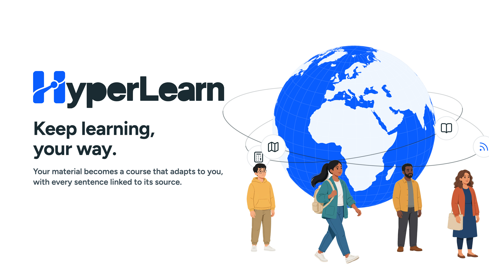
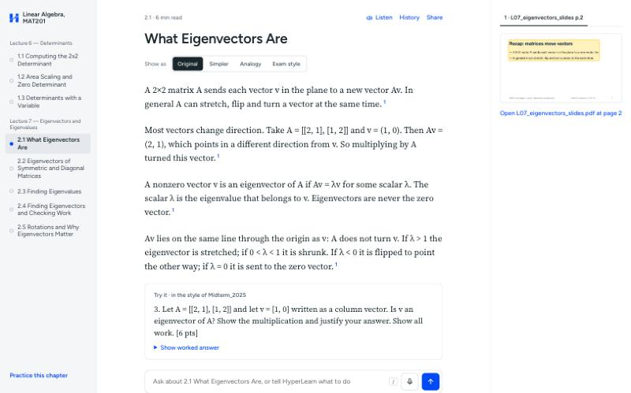
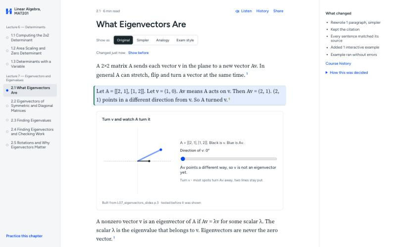
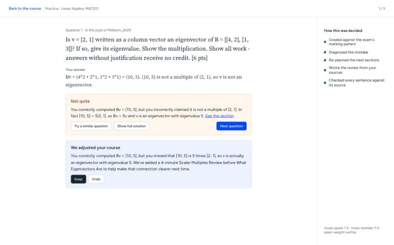
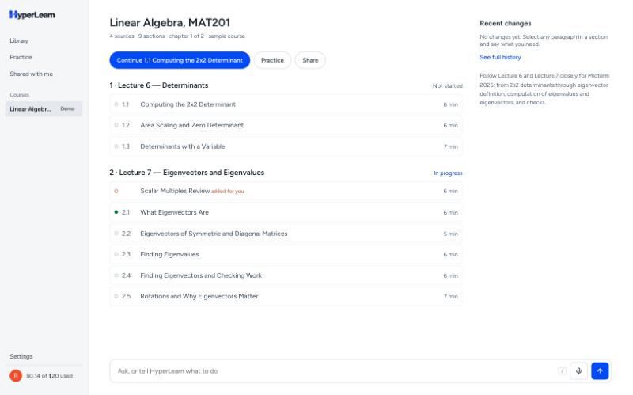
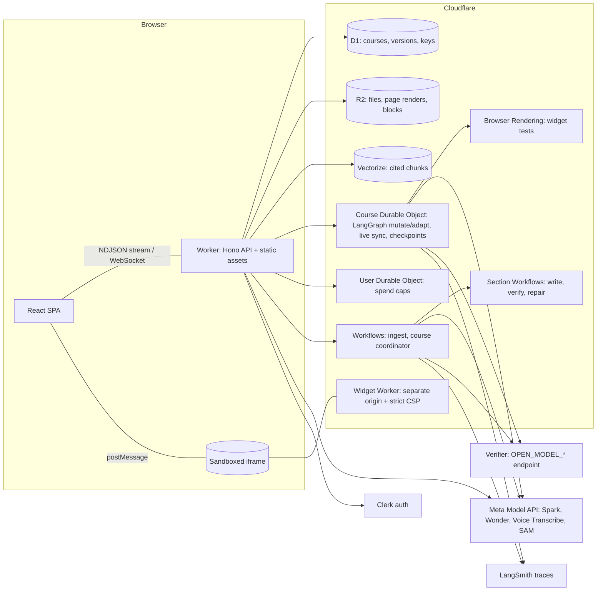

<p align="center"></p>

# HyperLearn

**A learning path that adapts to you, built from your own lectures, slides and papers. Every line links back to its source.**

Live: **https://hyperlearn.radesh-govind.com** (sign in, then open the sample course; demo mode needs no API key)

[](https://www.youtube.com/watch?v=M0JBMwNxeFQ)

**[Watch on YouTube](https://www.youtube.com/watch?v=M0JBMwNxeFQ)** · [More on YouTube](https://www.youtube.com/watch?v=Xmbh7Y9NFPE) · [Vertical version (Shorts)](https://youtube.com/shorts/-vZEYzJ1mKw)

HyperLearn turns a student's own material into a course:

- **Every sentence is cited.** Click a citation and the source pane shows the exact page with the region highlighted, or plays the lecture recording from that second.
- **Change anything.** Select a paragraph and say "this is too complex, simplify it and give me an interactive example". The section changes in place: the AI emits patch operations, every new sentence is checked against its cited source, the interactive example is recomputed in code and tested in a real browser. The change is saved as soon as it passes, so the next request builds on it; **Undo** puts the section back.
- **Interactive examples you can actually play with.** Plots keep fixed, labelled axes so a slider visibly moves the curve; you drag a probe along it and read values live; each example sets a goal it checks in code ("push the frequency past 200 W", "find both eigen-directions").
- **Practice in the style of your past exam, in 25 question types.** Multiple choice, select-all, true-or-false-then-fix, two-tier, numeric, maths expressions (checked for equivalence), three kinds of cloze, matching, ordering, Parsons problems, sorting, grids, highlighting, clicking the right spot on your own slide, labelling a slide, interactive challenges, estimation, spot-the-error and faded worked examples are graded in code the moment you answer; short answers, exam problems, justifications and "explain it out loud" are marked by Muse Spark against the exam's rubric. You also say how sure you are. A wrong answer re-plans your path (Muse Wonder inserts a short review from your own sources, as a diff you can keep or undo).
- **No blocking waits.** A practice round opens immediately and the first question is ready in seconds while the rest are written behind it; long steps show what is happening and for how long.
- **Listen.** Muse Spark rewrites each section as a spoken script (so "λ² − 7λ + 10" is read as "lambda squared minus seven lambda plus ten") spoken by MeloTTS, an open-weight voice that runs on Workers AI. The audio is made in the background whenever a page changes and stored by content in R2, so Listen starts at once and unchanged paragraphs are never spoken twice (the browser voice covers any clip that is missing); "Ask by voice" pauses and answers aloud.
- **Share.** Others can **follow** your course (live updates, their own changes stay private) or **copy** it (their own version that can still pull your updates).
- **A command bar on every screen** (`/` or Cmd+K, or speak to it) calls the same tools as the UI.

<!-- screenshots -->
| Reader with citations | Change anything | Practice re-plan | Path adapted |
|---|---|---|---|
|  |  |  |  |

## Which Meta model does which job

| Model | Job in HyperLearn |
|---|---|
| **Muse Spark** (`muse-spark-1.3`) | Structures PDFs and slides, writes and rephrases blocks, extracts the exam style, writes practice questions in 25 types, marks open answers, classifies requests, routes the command bar (tool calling), judges widget screenshots, writes the Listen script |
| **Muse Wonder** (`muse-wonder-1.0`) | Re-plans the learning path after a practice mistake (a small path diff, called rarely) |
| **Muse Voice Transcribe** (`muse-voice-transcribe-1.0`) | Lecture recordings → timestamped passages (audio citations); realtime mic input for the command bar, "Ask by voice" in Listen mode and "explain it out loud" practice answers |
| **SAM 3.1** (`sam-3.1`) | Segmentation client and parser for cutting figures out of slide pages |
| **Verifier slot** (`OPEN_MODEL_*`, OpenAI-compatible) | Checks every rewritten sentence against its cited passage. Built for an open-weight model (Muse Spark Open on Modal, or Muse Glimmer via vLLM): set a base URL + model id and it switches over. The live deployment currently points it at Muse Spark on the Meta Model API, and the UI labels it that way |
| Muse Image (`muse-image-1.0`) | Draws the picture at the top of every page (in one house style, labelled "drawn by Muse Image") and any illustration a student asks for when no interactive template fits; Muse Spark briefs it and then looks at the result before it is shown |

Three things the Meta Model API does not offer, and what we used instead: there is **no text-to-speech model** (Muse Voice Transcribe is speech to text only), so Listen uses the open-weight MeloTTS voice on Workers AI (`@cf/myshell-ai/melotts`), pre-generated on every change and cached in R2, reading a script Muse Spark writes, with the browser voice as fallback; there is **no embeddings endpoint**, so retrieval uses Workers AI `bge-base-en-v1.5` in Cloudflare Vectorize; **Muse Code has no API model id** (it is a coding CLI), so custom HTML widgets are written by Muse Spark and run in a sandbox on a separate origin.

## How verification works

The AI never rewrites a whole section. A section is a list of typed blocks (text, figure, widget, exercise); a change is a list of patch ops (`replace`, `insertAfter`, `remove`, `move`). Untouched blocks stay byte-identical (content-addressed in R2), so their citations stay valid and undo is just "previous version".

Before you see a change, `mutateGraph` (LangGraph.js inside a Durable Object) runs:

1. **Sentence check:** every new sentence is checked against the passage it cites by the verifier model (a separate call with its own prompt; designed for an open-weight model behind `OPEN_MODEL_*`).
2. **Claim check (code, not a model):** a widget's `claims` (e.g. `A * [1, 1] == 3 * [1, 1]`) are recomputed with mathjs, and structural checks reject a slider the curve ignores or a goal that cannot be reached.
3. **Browser check:** the widget is loaded in Cloudflare Browser Rendering; any console error fails it, every slider is moved and must change the screenshot, and Muse Spark judges the final screenshot against the request.
4. **Retry, then drop:** failures go back to the writers with the error (max 2 retries); anything still unsupported is removed and the "What changed" panel says so.
5. **Save / Undo:** a verified change is committed right away (a new version for owners, a personal overlay for everyone else); Undo commits the previous blocks back. LangGraph checkpoints live in the Durable Object's SQLite, so runs survive eviction.

Every run shows "How this was decided" (each step and the models used) and is traced to LangSmith.

**Eval (citation faithfulness):** 18 real "change anything" requests on the live demo course ("simplify", "add an analogy", "show worked examples", "add a plot I can play with", …), each run through the full verify loop and then undone. An independent judge (Muse Spark, separate from the in-loop verifier) checked every rewritten sentence against the passage it cites: **82 of 88 sentences supported (93.2%)**, 93.8% mean per request. Each scored run is logged to LangSmith (project `hyperlearn-eval`); reproduce with `node scripts/eval.mjs --remote`. The weakest requests were "break it into simpler sentences" and "explain it like I'm new", where simplifying added framing the slides don't state.

## Architecture



- **Ingest (Workflow):** PDF text with positions (unpdf) → regions with bounding boxes → Muse Spark structure and exam style → embeddings → Vectorize. Page images are rendered in the browser at upload (Workers have no canvas). Audio is cut into 16 kHz WAV parts in the browser and transcribed with timestamps.
- **Build (Workflows):** a coordinator plans the outline and starts one child Workflow per section. Each child writes at most six text blocks and one exam-style exercise, then verifies all its sentences in one structured request using only each block’s cited evidence. One rewrite/recheck is allowed; API and JSON retries stay bounded, with no additional Workflow retries around model calls. Results live in D1 under the build attempt; the coordinator publishes version 1 atomically only when every section succeeds. Completed steps are reused on replay. Owners can retry failed builds from the existing uploads; older attempts cannot publish.
- **Bring your own key:** keys are encrypted with AES-GCM (bound to the Clerk user id) and only decrypted per request. Without a key you are in demo mode on our key, under a hard global cap.
- **Free-tier guard:** one Durable Object counts R2 storage and operations, Vectorize vectors and queries, Workers AI calls and Browser Rendering tests, capped at ~80% of each Cloudflare free allowance. When a cap is reached, uploads pause with a message to contact contact@radesh-govind.com; existing courses keep working.
- **Security:** source text and web pages are wrapped as data in prompts; all model output is validated with zod; custom widgets run in `<iframe sandbox="allow-scripts">` on `hyperlearn-widgets.radesh-govind.com` with `default-src 'none'`.

## Built during the hackathon

Everything in this repository was built during the Meta Global AI Developer Hackathon (Nov 2–4, 2026). See [HACKATHON_LOG.md](HACKATHON_LOG.md) for the dated log and the git history for every step. The demo material in `seed/` (two lecture decks, a midterm and a synthetic lecture recording) was written for this project and is CC BY 4.0.

## Run locally

Requirements: Node 20+, a Cloudflare account (Workers Paid recommended), a Clerk app, a Meta Model API key.

```bash
npm install
cp .dev.vars.example .dev.vars   # fill in the keys; KEY_ENCRYPTION_KEY = `openssl rand -base64 32`
npx wrangler login
npm run db:migrate:local
npm run dev                      # http://localhost:5173
```

`LOCAL_ONLY=1 npm run dev` runs without a Cloudflare login (AI, Vectorize and Browser Rendering are then unavailable).

Deploy and seed:

```bash
./scripts/provision.sh           # D1, R2, Vectorize, migrations, secrets, both Workers
npm run seed:make                # regenerate seed/ (macOS)
npm run seed:prod                # ingest seed/ and build the demo course
node scripts/eval.mjs --remote   # LangSmith eval
```

Checks: `npm run typecheck`, `npm run lint`, `npm test` (Vitest in the Workers runtime: patch application, citation verification parsing, widget claim checks, key encryption, SAM parsing, LangGraph interrupt/resume, section build request budgets, evidence isolation, duplicate delivery and stale-attempt publication).

## License

Code: MIT. Demo material in `seed/`: CC BY 4.0.
