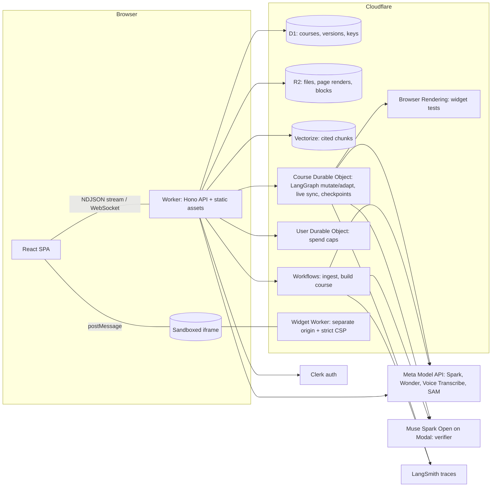

<p align="center"></p>

# HyperLearn

**A learning path that adapts to you, built from your own lectures, slides and papers. Every line links back to its source.**

Live: **https://hyperlearn.radesh-govind.com** (sign in, then open the sample course; demo mode needs no API key)

HyperLearn turns a student's own material into a course:

- **Every sentence is cited.** Click a citation and the source pane shows the exact page with the region highlighted, or plays the lecture recording from that second.
- **Change anything.** Select a paragraph and say "this is too complex, simplify it and give me an interactive example". The section changes in place: the AI emits patch operations, every new sentence is checked against its cited source, the interactive example is recomputed in code and tested in a real browser, and you choose **Keep** or **Undo**.
- **Practice in the style of your past exam.** A wrong answer re-plans your path (Muse Wonder inserts a short review from your own sources, as a diff you can keep or undo).
- **Share.** Others can **follow** your course (live updates, their own changes stay private) or **copy** it (their own version that can still pull your updates).
- **A command bar on every screen** (`/` or Cmd+K, or speak to it) calls the same tools as the UI.

<!-- screenshots -->
| Reader with citations | Change anything | Practice re-plan |
|---|---|---|
|  |  |  |

## Which Meta model does which job

| Model | Job in HyperLearn |
|---|---|
| **Muse Spark** (`muse-spark-1.3`) | Structures PDFs and slides, writes and rephrases blocks, extracts the exam style, grades answers, classifies requests, routes the command bar (tool calling), judges widget screenshots |
| **Muse Wonder** (`muse-wonder-1.0`) | Re-plans the learning path after a practice mistake (a small path diff, called rarely) |
| **Muse Voice Transcribe** (`muse-voice-transcribe-1.0`) | Lecture recordings → timestamped passages (audio citations); realtime mic input for the command bar |
| **SAM 3.1** (`sam-3.1`) | Segmentation client and parser for cutting figures out of slide pages |
| **Muse Spark Open** (open weights, on Modal) | Independent verifier: checks every rewritten sentence against its cited passage |
| Muse Image | Not used in v1 |

Two things the Meta Model API does not offer, and what we used instead: there is **no embeddings endpoint**, so retrieval uses Workers AI `bge-base-en-v1.5` in Cloudflare Vectorize; **Muse Code has no API model id** (it is a coding CLI), so custom HTML widgets are written by Muse Spark and run in a sandbox on a separate origin.

## How verification works

The AI never rewrites a whole section. A section is a list of typed blocks (text, figure, widget, exercise); a change is a list of patch ops (`replace`, `insertAfter`, `remove`, `move`). Untouched blocks stay byte-identical (content-addressed in R2), so their citations stay valid and undo is just "previous version".

Before you see a change, `mutateGraph` (LangGraph.js inside a Durable Object) runs:

1. **Sentence check (open weights):** every new sentence is checked against the passage it cites by Muse Spark Open, a different model from the writer.
2. **Claim check (code, not a model):** a widget's `claims` (e.g. `A * [1, 1] == 3 * [1, 1]`) are recomputed with mathjs.
3. **Browser check:** the widget is loaded in Cloudflare Browser Rendering; any console error fails it, and Muse Spark judges the screenshot against the request.
4. **Retry, then drop:** failures go back to the writers with the error (max 2 retries); anything still unsupported is removed and the "What changed" panel says so.
5. **Keep / Undo:** the graph pauses with `interrupt()`; its checkpoint lives in the Durable Object's SQLite, so it survives eviction.

Every run shows "How this was decided" (each step and the models used) and is traced to LangSmith.

**Eval:** 18 real change requests on the demo course, scored by an independent judge (citation faithfulness = share of rewritten sentences supported by their cited passage): **EVAL_SCORE** (LangSmith experiment `EVAL_EXPERIMENT`).

## Architecture



- **Ingest (Workflow):** PDF text with positions (unpdf) → regions with bounding boxes → Muse Spark structure and exam style → embeddings → Vectorize. Page images are rendered in the browser at upload (Workers have no canvas). Audio is cut into 16 kHz WAV parts in the browser and transcribed with timestamps.
- **Build (Workflow):** outline → sections written source-first with chunk citations → exam-style exercises → sentence verification → version 1.
- **Bring your own key:** keys are encrypted with AES-GCM (bound to the Clerk user id) and only decrypted per request. Without a key you are in demo mode on our key, under a hard global cap.
- **Security:** source text and web pages are wrapped as data in prompts; all model output is validated with zod; custom widgets run in `<iframe sandbox="allow-scripts">` on `hyperlearn-widgets.radesh-govind.com` with `default-src 'none'`.

## Built during the hackathon

Everything in this repository was built during the Meta Global AI Developer Hackathon (Nov 2–4, 2026). See [HACKATHON_LOG.md](HACKATHON_LOG.md) for the dated log and the git history for every step. The demo material in `seed/` (two lecture decks, a midterm and a synthetic lecture recording) was written for this project and is CC BY 4.0.

## Run locally

Requirements: Node 20+, a Cloudflare account (Workers Paid recommended), a Clerk app, a Meta Model API key.

```bash
npm install
cp .dev.vars.example .dev.vars   # fill in the keys; KEY_ENCRYPTION_KEY = `openssl rand -base64 32`
npx wrangler login
npm run db:migrate:local
npm run dev                      # http://localhost:5173
```

`LOCAL_ONLY=1 npm run dev` runs without a Cloudflare login (AI, Vectorize and Browser Rendering are then unavailable).

Deploy and seed:

```bash
./scripts/provision.sh           # D1, R2, Vectorize, migrations, secrets, both Workers
npm run seed:make                # regenerate seed/ (macOS)
npm run seed:prod                # ingest seed/ and build the demo course
node scripts/eval.mjs --remote   # LangSmith eval
```

Checks: `npm run typecheck`, `npm run lint`, `npm test` (Vitest in the Workers runtime: patch application, citation verification parsing, widget claim checks, key encryption, SAM parsing, LangGraph interrupt/resume).

## License

Code: MIT. Demo material in `seed/`: CC BY 4.0.
